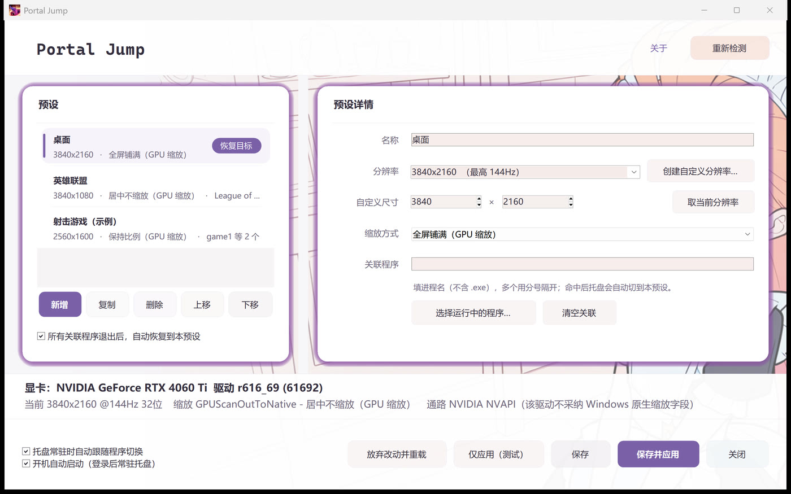
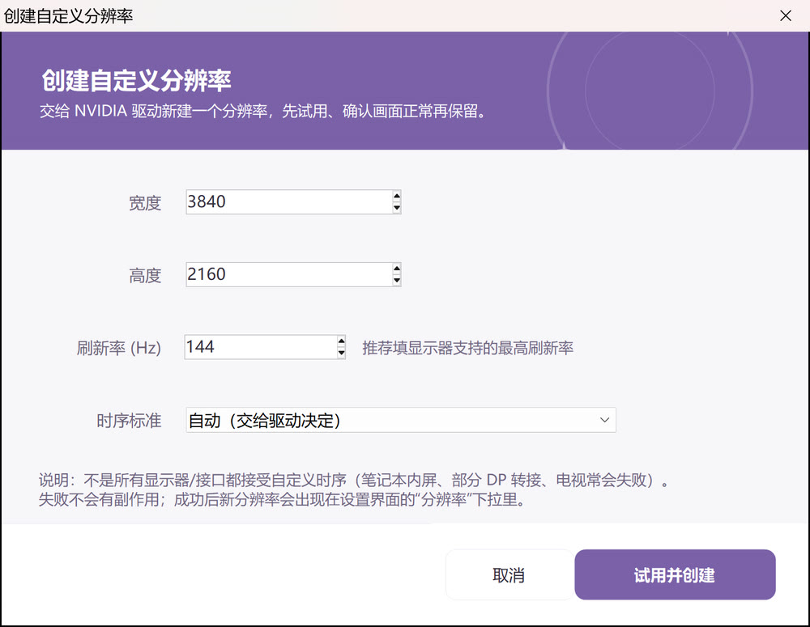

# 折返跃迁 Portal Jump

> 按程序自动切换显示分辨率与缩放模式的 Windows 小工具。
> 打开游戏自动切到游戏分辨率，退出后自动切回桌面。

<p align="center">
  
</p>

<p align="center">
  <sub>设置界面：左侧预设列表，右侧预设详情与当前显卡状态</sub>
</p>

---

## 这是什么

一个常驻托盘的 Windows 工具。你事先把「某个程序」和「一套显示配置」绑定起来，
之后打开那个程序，它自动把显示器切到对应分辨率和缩放方式；程序退出后自动切回去。

典型用法：

- 玩《三角洲行动》想用 **2560×1440 + 居中不缩放**，平时办公用 **3840×2160 + 全屏铺满**
- 玩《英雄联盟》想用 **3840×1080 带鱼屏视野**，退出后回到 4K
- 笔记本接显示器，不同场景用不同分辨率

手动在系统设置里来回切分辨率又慢又麻烦，这个工具让它变成"打开程序就自动完成"。

---

## 特性

| 特性 | 说明 |
|---|---|
| **按程序自动切换** | 轮询检测关联进程，命中即切换，全部退出后自动恢复 |
| **分辨率 + 缩放一起切** | 不只是分辨率，缩放方式（全屏铺满 / 保持比例 / 居中不缩放 / 整数缩放）也一起切 |
| **切换后看门狗** | 游戏启动后常会自己再改一次分辨率，工具会在 12 秒内发现并纠正 |
| **回读校验** | 每次切换后回读确认，不轻信 API 返回值（驱动忙时会"假成功"） |
| **绿色免安装** | 解压即用，配置在同目录，整个文件夹拷走就能带走配置 |
| **托盘常驻，占用小** | 无主窗口，约 32 MB 内存 |
| **配置热加载** | 改完 `presets.ini` 保存，托盘自动生效，不用重启 |

---

## 运行要求

| 你的显卡 | 缩放方式 | 整数缩放 | 创建自定义分辨率 |
|---|---|---|---|
| **NVIDIA** | NVIDIA NVAPI | 支持 | 支持 |
| **AMD** | AMD 官方 ADLX | 支持 | 支持 |
| 其它 | Windows 原生接口 | — | 不在程序内提供 |

- Windows 10 / 11（64 位）
- .NET Framework 4.8（Win10 1903+ 与 Win11 已内置）

---

## 下载

到 [Releases](../../releases) 页面下载对应你显卡的压缩包，解压后双击 `PortalJump.exe` 即可，无需安装。

| 包名 | 适用 | 说明 |
|---|---|---|
| `折返跃迁vX.Y-NVIDIA显卡版.zip` | NVIDIA 显卡 | 缩放走 NVAPI，功能最全 |
| `折返跃迁vX.Y-AMD显卡版.zip` | AMD 显卡 | 缩放走 AMD 官方 ADLX |
| `折返跃迁vX.Y-合并版.zip` | NVIDIA 或 AMD | 一个包，启动时自动识别显卡并选择通路 |

包里包含：

```
PortalJump.exe        托盘主程序
PortalJump.UI.exe     设置界面
NvAPIWrapper.dll      NVAPI 封装（NVIDIA / 合并版需要，请不要删）
使用说明.md / LICENSE.txt / 环境自检.cmd
presets.example.ini + 图标素材
```

---

## 快速上手

1. 解压，双击 `PortalJump.exe` —— 右下角托盘出现图标（没有主窗口，这是正常的）
2. 右键托盘图标 →「打开设置界面」
3. 「新增」一个预设：填名称、选分辨率与缩放方式 →「关联程序」里勾上你的游戏 →「保存并应用」
4. 之后打开那个游戏，就会自动切换了

**建议先做这一步**：NVIDIA 控制面板 →「显示」→「调整桌面尺寸和位置」，
取消勾选「覆盖由游戏和程序设置的缩放模式」，点应用。
不做这步可能分辨率能切但缩放不变——这是 NVIDIA 上最常见的坑。

---

## 自定义分辨率

列表里没有想要的分辨率时，用「创建自定义分辨率…」交给驱动新建一个。
先试用，画面正常再保留；失败不会留下副作用。

<p align="center">
  
</p>

---

---

## 配置

配置文件是 `presets.ini`，可以直接用记事本改，也可以用界面改。

```ini
[general]
autoswitch=1
fixresidual=1
restore=office

[office]
name=办公
width=3840
height=2160
scaling=fullscreen-gpu

[game]
name=三角洲行动
width=2560
height=1440
scaling=centered-gpu
process=DeltaForceClient-Win64-Shipping
```

`scaling` 可选值：

| 值 | 含义 |
|---|---|
| `unchanged` | 不改动，保持当前设置 |
| `fullscreen-gpu` | 全屏铺满，GPU 缩放 |
| `fullscreen-display` | 全屏铺满，显示器缩放 |
| `aspect-gpu` | 保持比例，GPU 缩放 |
| `aspect-display` | 保持比例，显示器缩放 |
| `centered-gpu` | 居中不缩放，GPU 缩放 |
| `centered-display` | 居中不缩放，显示器缩放 |
| `integer-gpu` | 整数缩放 |

> 旧版配置里的数字（`0`/`1`/`2`/`3`/`5`/`6`/`7`/`8`）会被自动识别并迁移，不用手改。

`process` 填进程名（不含 `.exe`，多个用分号隔开）。不知道进程名？
用设置界面里的「选择运行中的程序…」最省事。

---

## 从源码构建

需要系统自带的 .NET Framework 4.8 工具链（`csc.exe` / `MSBuild.exe`），
**不需要 Visual Studio、不需要 .NET SDK、不需要联网**。

```powershell
cd res-switch
.\build.ps1 -Ui -Dist -Zip
```

产出：

```
PortalJump\PortalJump.exe            托盘主程序（NVIDIA 版）
PortalJump\PortalJump-generic.exe    托盘主程序（AMD 版）
PortalJump\PortalJump-resonly.exe    托盘主程序（仅分辨率版）
PortalJump\nvidia\PortalJump.UI.exe  NVIDIA 版界面
PortalJump\generic\PortalJump.UI.exe AMD 版界面
dist\                                分发包
```

构建**合并版**（一个 exe 同时带 NVAPI 与 ADLX，运行时自动识别显卡）：

```powershell
$csc = "$env:WINDIR\Microsoft.NET\Framework64\v4.0.30319\csc.exe"
& $csc /nologo /utf8output /codepage:65001 /target:winexe /optimize+ `
  /define:UNIFIED /define:WITH_NVAPI /out:PortalJump\unified\PortalJump.exe `
  /r:System.dll /r:System.Core.dll /r:System.Drawing.dll /r:System.Windows.Forms.dll `
  /r:NvAPIWrapper.dll src\*.cs

$msbuild = "$env:WINDIR\Microsoft.NET\Framework64\v4.0.30319\MSBuild.exe"
& $msbuild src-ui\PortalJump.UI.csproj /p:Configuration=Release /p:Unified=true
```

> 若源码里还没有 `UNIFIED` 分支，先跑一次 `scripts\apply-unified-patch.ps1 -Root .`（幂等）。

### 代码结构

```
src\                     托盘进程 + 界面共用的核心
  Scaling.cs             缩放语义层
  DisplayConfigBackend.cs 显示配置后端（Win32 DEVMODE + CCD）
  NvapiBridge.cs         NVAPI 隔离层（NVIDIA 通路）
  AdlxBridge.cs          ADLX 桥接层（AMD 通路，运行时动态加载 amdadlx64.dll）
  GpuExtensions.cs       版本能力开关（编译符号：WITH_NVAPI / UNIFIED / RESOLUTION_ONLY）
  Switcher.cs            切换逻辑、后端选择、回读校验
  Program.cs             入口、托盘、进程监控、看门狗
src-ui\                  界面进程（WPF）
tools\                   回归测试与诊断工具
```

> 两套厂商桥接都是**运行时**加载（`NvAPIWrapper.dll` / `amdadlx64.dll`），
> 所以识别到 A 卡时会完全跳过 NVAPI、识别到 N 卡时也不会去碰 ADLX。

几个改代码时容易踩的点：

- **缩放必须并进"切到非原生分辨率"的那一次调用**：Windows 只在源尺寸 ≠ 目标尺寸时才有缩放概念，
  先切分辨率再单独设缩放会被驱动拒绝。
- **切换成败以回读为准**：`ChangeDisplaySettingsEx` 返回 0 不代表模式真的变了（驱动忙时会假成功）。
- **分辨率成功即算整体成功**：缩放失败不要让 `Apply` 返回 false，否则托盘会反复重试、越试越糟。
- **`DISPLAYCONFIG_PATH_INFO` 末尾必须有 `UINT32 flags`**（结构 72 字节），少了会堆损坏崩进程。
- **`DEVMODEA` 是 156 字节**，不是 160。

---

## 测试

测试工具都是单个 `.cs` 文件，用系统自带的 `csc.exe` 编一下就能跑（详见 `tools\README.md`）：

```powershell
$csc = "$env:WINDIR\Microsoft.NET\Framework64\v4.0.30319\csc.exe"
cd tools
& $csc /nologo /utf8output /codepage:65001 /target:exe /out:ConfigTest.exe ConfigTest.cs
& $csc /nologo /utf8output /codepage:65001 /target:exe /out:SwitchTest.exe SwitchTest.cs ..\src\Scaling.cs
& $csc /nologo /utf8output /codepage:65001 /target:exe /out:WatchdogTest.exe WatchdogTest.cs

.\ConfigTest.exe  ..\PortalJump\presets.ini            # 配置层回归
.\SwitchTest.exe  ..\PortalJump\PortalJump.exe         # 真实切换（会改屏幕，自动还原）
.\WatchdogTest.exe ..\PortalJump\PortalJump.exe .\rsprobe-game.exe  # 看门狗
```

AMD 通路（在 AMD 机器上跑，详见 `tools\README.md`）：

```powershell
& $csc /nologo /unsafe /target:exe /out:adlx-diag.exe adlx-diag.cs
.\adlx-diag.exe   # 纯只读：枚举显示器、报告 ADLX 三类缩放接口是否可用
```

---

## 已知限制

- **NVIDIA 与 AMD 已实机验证**；其它显卡走 Windows 原生接口，仅基础缩放（不在程序内提供整数缩放与自定义分辨率）。
- **合并版的 AMD 通路尚未实机验证**（代码与已验证的 AMD 版一致，但"自动识别分流"这一整合形态需你在 A 卡机器上跑一次自检确认）。
- 进程检测是轮询（约 2 秒一次），不是事件驱动；极短命的进程可能漏掉。
- 切换后有 12 秒看门狗（最多纠正 3 次），超过就不再纠缠。
- 没有安装包，升级就是覆盖文件夹；配置在程序目录或 `%APPDATA%\PortalJump\`，不会被覆盖。
- 自定义分辨率的保护机制是「15 秒内不确认就还原」，但如果驱动在试验阶段直接卡死，仍需手动重启。

---

## 免责声明

本工具会**直接通过显示驱动修改分辨率、刷新率与缩放模式**，并可创建自定义分辨率，
可能出现黑屏、花屏、显示异常等情况。

使用前请自行确认显示器与驱动支持你要设置的模式；因使用本工具造成的任何直接或间接损失
（含数据丢失、工作中断、硬件损坏），作者不承担任何责任。

本工具为个人免费作品，按「现状」提供，不提供任何担保，与 NVIDIA、AMD 公司无关联。
继续使用即表示接受以上内容，不同意请不要运行。

---

## 作者

**区区之数** · B 站主页：https://space.bilibili.com/21100323

如果这个工具帮到了你，欢迎点个 Star ⭐
